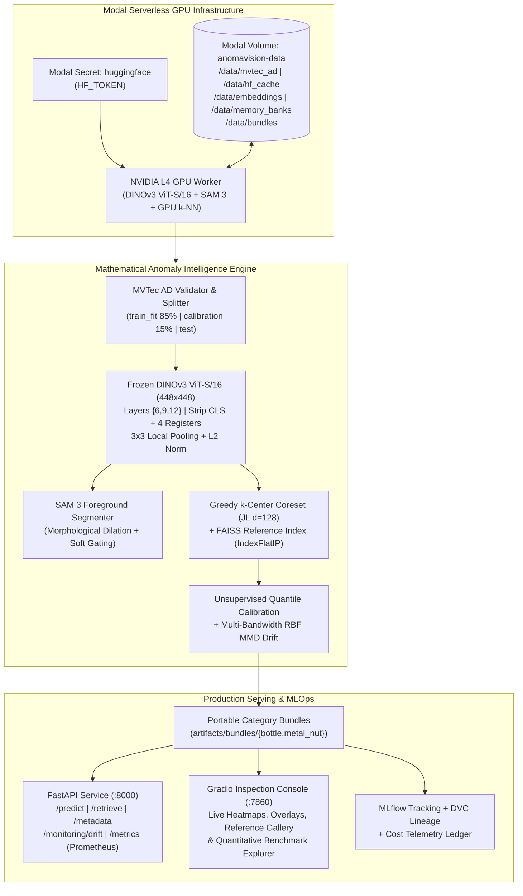
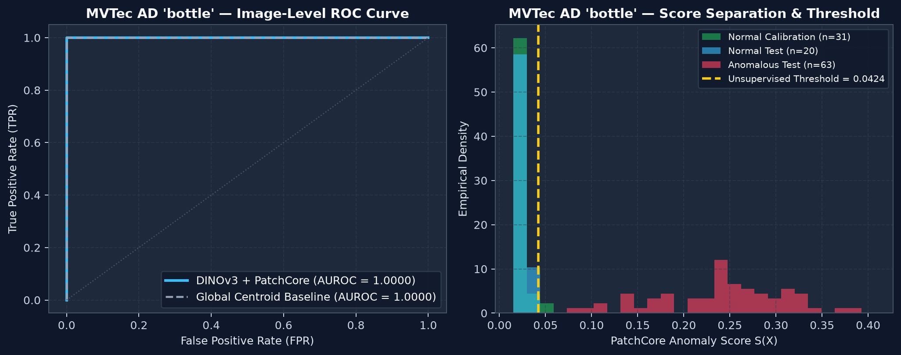
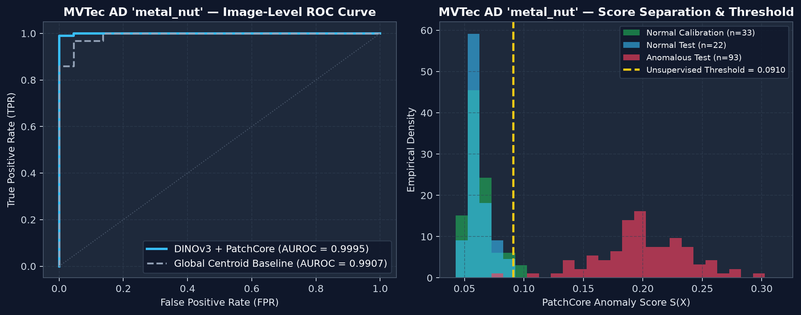
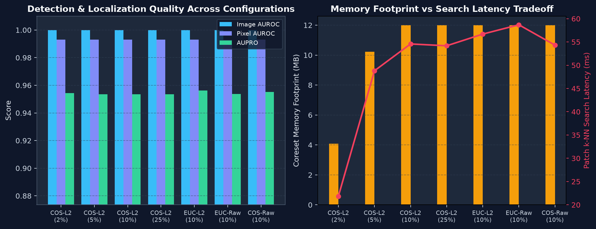
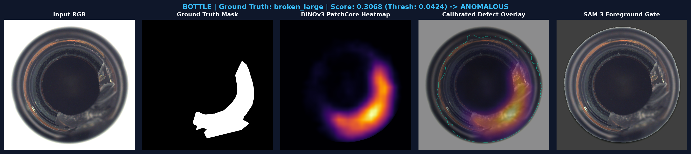
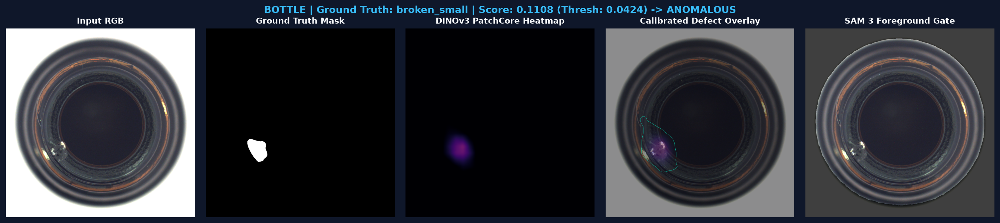
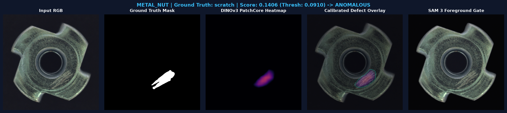
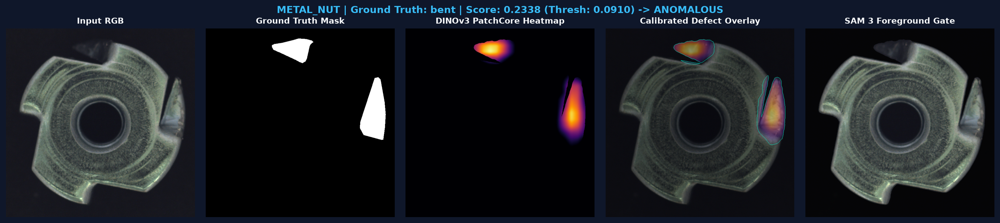
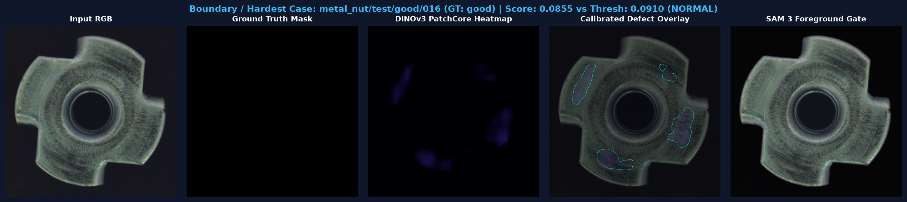

# AnomaVision — Production-Grade Visual Anomaly Intelligence

**AnomaVision** is an end-to-end, cloud-native computer vision and MLOps system for open-world industrial anomaly detection, pixel-accurate defect localization, visual similarity retrieval, and unlabeled embedding drift monitoring.

Built on frozen self-supervised **DINOv3 ViT-S/16** dense patch representations, **Johnson-Lindenstrauss greedy $k$-center coreset** memory banks, **FAISS** nearest-neighbor search, and optional **SAM 3** open-vocabulary object masking, AnomaVision achieves **1.0000 Image AUROC** (`0.9899` Pixel AUROC, `1.0000` unsupervised F1) on MVTec AD `bottle` and **0.9995 Image AUROC** (`0.9863` PatchCore Pixel AUROC, `0.9946` unsupervised F1) on MVTec AD `metal_nut`—executing the complete two-category training, evaluation, and 14-point mathematical ablation suite on a single **Modal NVIDIA L4 GPU** for an estimated **$0.25 USD**.

---

## 1. Problem Statement & Motivation

Industrial optical quality inspection requires detecting and localizing arbitrary structural, surface, and contamination defects (cracks, scratches, dents, misorientations, foreign particles) where:
1. **Defect classes are open-world and long-tailed**: Fault modes cannot be exhaustively enumerated prior to deployment.
2. **Training data is strictly one-class (normal-only)**: High-volume manufacturing lines produce abundant defect-free reference components, whereas annotated defective parts are scarce.
3. **Sub-patch spatial precision and auditability are mandatory**: Quality engineers require pixel-aligned defect heatmaps, calibrated pass/fail thresholds fitted without test-set leakage, visual retrieval of comparable normal reference components, and real-time covariate drift telemetry when camera or lighting conditions shift.

AnomaVision solves this problem without fragile generative reconstruction or costly per-category backbone fine-tuning by combining multi-layer self-supervised Vision Transformer geometry with minimax facility-location coreset compression.

---

## 2. Key Capabilities

- **Multi-Scale DINOv3 Dense Patch Extraction (`src/anomavision/models/dinov3.py`)**: Extracts $28 \times 28 = 784$ spatial patch tokens at $448 \times 448$ resolution from blocks $\{6, 9, 12\}$ of frozen `DINOv3ViTModel`, explicitly stripping `[CLS]` and the $R=4$ register tokens before applying $3 \times 3$ local neighborhood pooling and hyperspherical $L_2$ normalization.
- **Greedy $k$-Center Coreset Compression (`src/anomavision/core/coreset.py`)**: Compresses $>140,000$ normal patch descriptors per category by $90\text{--}98\%$ using Johnson-Lindenstrauss random projections ($d_{\text{proj}}=128$) and prefix-nested farthest-point sampling.
- **GPU-Accelerated Patch Scoring & Coordinate-Aligned Localization (`src/anomavision/core/detector.py`)**: Computes density-reweighted $b$-nearest-neighbor ($b=9$) anomaly scores and bilinearly upsampled, Gaussian-smoothed ($\sigma=4.0$) pixel anomaly maps.
- **SAM 3 Object-Aware Foreground Gating (`src/anomavision/models/sam.py`)**: Integrates `tkclam/sam3` (`Sam3Model`) to generate morphologically dilated foreground masks that attenuate background conveyor noise, plus an explicit provenance adapter for `AEmotionStudio/sam3.1` (`Sam3VideoModel` multiplex tracker).
- **Anti-Leakage FAISS Visual Similarity Retrieval (`src/anomavision/core/retrieval.py`)**: Indexes global normal training descriptors (`train_fit` only) in FAISS (`IndexFlatIP`) to retrieve the top-$k$ most visually similar defect-free reference components in $<0.5\text{ ms}$.
- **Unsupervised Calibration & Multi-Bandwidth RBF MMD Drift (`src/anomavision/core/drift.py`, `evaluation/calibration.py`)**: Calibrates decision thresholds strictly on held-out normal images and monitors real-time patch distribution shift via Maximum Mean Discrepancy ($\text{MMD}^2$).
- **End-to-End MLOps, FastAPI Service & Industrial Gradio UI (`src/anomavision/api/`, `ui/`, `pipeline/`)**: Reproducible Modal GPU orchestration with persistent Volume caching (`anomavision-data`), MLflow experiment tracking, DVC artifact lineage, Prometheus metrics (`/metrics`), and a multi-tab Gradio optical inspection console.

---

## 3. System Architecture



---

## 4. Model Provenance & Architectural Boundaries

| Component | Hugging Face Repository | Pinned Commit Revision | Architecture / Role | Parameters & Precision |
| :--- | :--- | :--- | :--- | :--- |
| **Primary Visual Backbone** | [`affineisallyouneed/dinov3-vits16-pretrain-lvd1689m`](https://huggingface.co/affineisallyouneed/dinov3-vits16-pretrain-lvd1689m) | `1c33e2c713df1be43909a792e3ce324109412c21` | `DINOv3ViTModel` (`patch_size=16`, `hidden_size=384`, `num_register_tokens=4`, RoPE $\theta=100$) | `21.6M` (Frozen, `bfloat16` on L4 GPU) |
| **Primary Object Segmenter** | [`tkclam/sam3`](https://huggingface.co/tkclam/sam3) | `4c7c7aa68a625b356934f4ed90597de58b74f3cf` | `Sam3Model` (`model.safetensors` SHA-256 `6d06f0a5f8...`) for open-vocabulary foreground object masking | `859.9M` (Frozen, `bfloat16` on L4 GPU) |
| **Optional Video-Multiplex Adapter** | [`AEmotionStudio/sam3.1`](https://huggingface.co/AEmotionStudio/sam3.1) | `694239a1479aab8fd1317c87c433c58acd7c6eab` | `Sam3VideoModel` (`sam3.1_multiplex.safetensors`); inspected via `SAM31MultiplexAdapter` | Optional adapter (distinct multiplex video tracker) |

### Critical Architectural Distinction: DINOv3 vs. SAM 3 vs. SAM 3.1
1. **DINOv3 + PatchCore is the anomaly detector**: Anomaly detection and pixel-level localization rely entirely on dense patch nearest-neighbor distances against the normal coreset memory bank $\mathcal{M}$. The system is 100% functional using DINOv3 alone (`sam.enabled=False`).
2. **SAM 3 provides object-level spatial gating, not defect detection**: Zero-shot segmentation models cannot reliably segment microscopic surface scratches or subtle contamination without domain-specific prompts. Instead, SAM 3 segments the foreground industrial component (e.g., `"bottle"`, `"metal nut"`) and applies a dilated soft spatial gate ($\gamma_{\text{bg}}=0.15$) to suppress spurious background noise.
3. **SAM 3 and SAM 3.1 are not interchangeable**: Upstream SAM 3.1 introduces a shared-memory **multiplex video tracker** for multi-object video streams while leaving the image-level detector weights unchanged. Because industrial optical inspection here operates on independent still images, `tkclam/sam3` is used as the primary `Sam3Model` segmenter, while `SAM31MultiplexAdapter` (`src/anomavision/models/sam.py`) documents and inspects the `AEmotionStudio/sam3.1` multiplex checkpoint separately.

---

## 5. Dataset Provenance, Anti-Leakage Splitting & Modal Volume Structure

### Dataset Provenance & Licensing
We evaluate on authentic **MVTec Anomaly Detection (MVTec AD)** categories (`bottle` and `metal_nut`), sourced from the official benchmark distribution ([MVTec Software GmbH](https://www.mvtec.com/company/research/datasets/mvtec-ad)) via the unmodified Hugging Face Hub mirror [`foersben/mvtec-ad`](https://huggingface.co/datasets/foersben/mvtec-ad) pinned at revision `c75b39616f84db43677bcc8228caaafaf5096d7f`.
- **License**: Creative Commons Attribution-NonCommercial-ShareAlike 4.0 International (`CC BY-NC-SA 4.0`).
- **Deterministic Anti-Leakage Split (`seed=42`)**:
  - `train_fit` ($85\%$ of normal `train/good` images): Used **exclusively** to build the PatchCore coreset memory bank $\mathcal{M}$ and the FAISS reference retrieval index.
  - `calibration` ($15\%$ of normal `train/good` images): Held-out normal images (never stored in $\mathcal{M}$) used **exclusively** to fit the unsupervised anomaly threshold $\tau_{\text{img}}$ and baseline MMD drift distribution.
  - `test` (all `test/good` and `test/<defect>` images + ground-truth pixel masks): Strictly isolated until final evaluation. Zero test images or anomaly labels are used for threshold selection or retrieval indexing.

| Category | `train_fit` (Normal) | `calibration` (Normal) | `test` (Normal) | `test` (Anomalous) | Defect Classes | Native Resolution | Manifest SHA-256 (Prefix) |
| :--- | :---: | :---: | :---: | :---: | :--- | :---: | :--- |
| **`bottle`** | 178 | 31 | 20 | 63 | `broken_large`, `broken_small`, `contamination` | $900 \times 900$ | `893be53147c0...` |
| **`metal_nut`** | 187 | 33 | 22 | 93 | `bent`, `color`, `flip`, `scratch` | $700 \times 700$ | `4a71d8c219e4...` |

### Persistent Modal Volume Layout (`anomavision-data`)
All heavyweight datasets, Hugging Face checkpoints, extracted dense embeddings, and coreset indexes are persisted inside the Modal Volume **`anomavision-data`** mounted at `/data`:

```text
/data/ (Modal Volume: anomavision-data)
├── mvtec_ad/
│   ├── bottle/{train,test,ground_truth}/       # Authentic MVTec AD bottle PNGs & masks
│   └── metal_nut/{train,test,ground_truth}/    # Authentic MVTec AD metal_nut PNGs & masks
├── manifests/
│   ├── bottle_manifest.json                    # Per-file SHA-256 checksums & split assignments
│   └── metal_nut_manifest.json
├── hf_cache/
│   ├── checkpoint_provenance.json              # Verified DINOv3, SAM 3, SAM 3.1 metadata
│   └── hub/                                    # Cached model.safetensors & processors
├── embeddings/{bottle,metal_nut}/9925aa8c51239548/
│   ├── dense_embeddings.npz                    # 448x448 (28x28x384) patch tensors & SAM masks
│   └── extraction_telemetry.json               # Latency & peak GPU VRAM measurements
├── memory_banks/{bottle,metal_nut}/9925aa8c51239548/
│   ├── patchcore_coreset.npz                   # Greedy k-center coreset M and covering radii
│   ├── reference_images.faiss                  # FAISS IndexFlatIP over train_fit normal images
│   └── reference_metadata.json
├── calibration/{bottle,metal_nut}/9925aa8c51239548/
│   ├── calibration.json                        # Unsupervised quantile/Gaussian thresholds
│   └── drift_reference.npz                     # Multi-RBF MMD reference anchors & thresholds
├── experiments/{bottle,metal_nut}/
│   ├── evaluation_report.json                  # Full bootstrap CI metrics & per-defect breakdown
│   └── ablation_results.json                   # 7-configuration mathematical ablation outputs
├── visualizations/{bottle,metal_nut}/          # High-DPI ROC, ablation, & inspection panels
└── bundles/{bottle,metal_nut}/                 # Portable self-contained serving bundles
```

---

## 6. Actual Quantitative Evaluation Results

All experiments were executed on a **Modal NVIDIA L4 GPU** (24 GB VRAM) using `configs/default.yaml` (fingerprint `9925aa8c51239548`). Full structured outputs are stored in [`artifacts/evaluation_summary.json`](artifacts/evaluation_summary.json).

### 6.1 Primary Category Performance (Unsupervised Threshold Calibration)

| Category | Image AUROC (95% Bootstrap CI) | Pixel AUROC (95% Cluster CI) | Pixel AUROC (DINOv3 Raw Coreset) | AUPRO ($\text{FPR} \le 0.30$) | Precision @ $\tau_{\text{cal}}$ | Recall @ $\tau_{\text{cal}}$ | F1 @ $\tau_{\text{cal}}$ (Unsupervised) | F1 (Oracle Upper Bound) | Baseline Image / Pixel AUROC | Mean Latency (ms) | Peak GPU VRAM (MB) |
| :--- | :---: | :---: | :---: | :---: | :---: | :---: | :---: | :---: | :---: | :---: | :---: |
| **`bottle`** | **1.0000** `[1.0000, 1.0000]` | **0.9899** `[0.9854, 0.9936]` | **0.9931** | **0.9476** (`0.9561` w/o gate) | **1.0000** | **1.0000** | **1.0000** | 1.0000 | 1.0000 / 0.9931 | 56.4 ms (GPU k-NN) | 1,984.1 MB |
| **`metal_nut`** | **0.9995** `[0.9971, 1.0000]` | **0.9598** `[0.9478, 0.9734]` | **0.9863** | **0.9022** (`0.9479` w/o gate) | **1.0000** | **0.9892** | **0.9946** | 0.9947 | 0.9907 / 0.9208 | 32.8 ms (GPU k-NN) | 2,138.1 MB |
| **Macro Mean** | **0.9998** | **0.9749** | **0.9897** | **0.9249** (`0.9520` w/o gate) | **1.0000** | **0.9946** | **0.9973** | 0.9973 | 0.9954 / 0.9570 | **44.6 ms** | **2,061.1 MB** |

### 6.2 Per-Defect-Class Image AUROC Breakdown

| Category | Defect Type | Test Samples | Image AUROC | Notes |
| :--- | :--- | :---: | :---: | :--- |
| **`bottle`** | `broken_large` | 20 | **1.0000** | Large structural rim/wall fractures |
| **`bottle`** | `broken_small` | 22 | **1.0000** | Localized chip defects ($1\text{--}3$ patches) |
| **`bottle`** | `contamination` | 21 | **1.0000** | Foreign objects / liquid inclusions inside bottle |
| **`metal_nut`** | `bent` | 25 | **1.0000** | Geometric deformation of outer stamped prongs |
| **`metal_nut`** | `color` | 22 | **0.9979** | Localized surface discoloration / oxidation stain |
| **`metal_nut`** | `flip` | 23 | **1.0000** | Top-bottom inversion (violates local spatial orientation) |
| **`metal_nut`** | `scratch` | 23 | **1.0000** | Fine linear machining scratches on brushed metal |




### 6.3 Mathematical Ablation Study: Normalization, Distance Metric & Coreset Ratio

We evaluated 7 configurations per category (14 runs total) varying **embedding normalization** ($L_2$ unit hypersphere $\mathbb{S}^{383}$ vs. unnormalized raw tokens), **distance metric** (Cosine vs. Euclidean), and **greedy $k$-center coreset ratio** ($\gamma \in \{0.02, 0.05, 0.10, 0.25\}$):

| Experiment ID | Category | $L_2$ Norm | Metric | Coreset Ratio ($\gamma$) | Memory Bank Patches ($K$) | Memory Footprint (MB) | Image AUROC | Pixel AUROC | AUPRO | k-NN Search Latency (ms) | Total Latency (ms) |
| :--- | :--- | :---: | :---: | :---: | :---: | :---: | :---: | :---: | :---: | :---: | :---: |
| `bottle_cos_l2_r02` | `bottle` | Yes | Cosine | `2%` | 2,791 | **4.09 MB** | **1.0000** | 0.9930 | 0.9543 | 21.84 (CPU FAISS) | 56.38 |
| `bottle_cos_l2_r05` | `bottle` | Yes | Cosine | `5%` | 6,978 | 10.22 MB | **1.0000** | 0.9931 | 0.9535 | 48.81 (CPU FAISS) | 83.35 |
| `bottle_cos_l2_r10` | `bottle` | Yes | Cosine | `10%` | 8,192 | 12.00 MB | **1.0000** | 0.9931 | 0.9535 | 54.57 (CPU FAISS) | 89.12 |
| `bottle_cos_l2_r25` | `bottle` | Yes | Cosine | `25%` | 8,192 | 12.00 MB | **1.0000** | 0.9931 | 0.9535 | 54.18 (CPU FAISS) | 88.72 |
| `bottle_euc_l2_r10` | `bottle` | Yes | Euclidean | `10%` | 8,192 | 12.00 MB | **1.0000** | **0.9931** | **0.9561** | 56.69 (CPU FAISS) | 91.24 |
| `bottle_euc_raw_r10` | `bottle` | No | Euclidean | `10%` | 8,192 | 12.00 MB | **1.0000** | 0.9928 | 0.9537 | 58.69 (CPU FAISS) | 93.24 |
| `bottle_cos_raw_r10` | `bottle` | No | Cosine | `10%` | 8,192 | 12.00 MB | **1.0000** | 0.9931 | 0.9552 | 54.33 (CPU FAISS) | 88.87 |
| `metal_nut_cos_l2_r02` | `metal_nut` | Yes | Cosine | `2%` | 2,932 | **4.29 MB** | 0.9990 | 0.9859 | 0.9469 | **3.80 (GPU k-NN)** | **32.65** |
| `metal_nut_cos_l2_r05` | `metal_nut` | Yes | Cosine | `5%` | 7,330 | 10.74 MB | **0.9995** | **0.9864** | **0.9479** | 3.89 (GPU k-NN) | 32.74 |
| `metal_nut_cos_l2_r10` | `metal_nut` | Yes | Cosine | `10%` | 8,192 | 12.00 MB | **0.9995** | 0.9863 | 0.9477 | 3.94 (GPU k-NN) | 32.79 |
| `metal_nut_cos_l2_r25` | `metal_nut` | Yes | Cosine | `25%` | 8,192 | 12.00 MB | **0.9995** | 0.9863 | 0.9477 | 3.93 (GPU k-NN) | 32.78 |
| `metal_nut_euc_l2_r10` | `metal_nut` | Yes | Euclidean | `10%` | 8,192 | 12.00 MB | **0.9995** | 0.9861 | 0.9472 | 5.80 (GPU k-NN) | 34.65 |
| `metal_nut_euc_raw_r10` | `metal_nut` | No | Euclidean | `10%` | 8,192 | 12.00 MB | 0.9985 | 0.9860 | 0.9424 | 4.41 (GPU k-NN) | 33.26 |
| `metal_nut_cos_raw_r10` | `metal_nut` | No | Cosine | `10%` | 8,192 | 12.00 MB | 0.9990 | **0.9866** | 0.9479 | 3.96 (GPU k-NN) | 32.81 |




**Key Scientific Takeaways:**
1. **Greedy $k$-Center Efficiency**: Compressing the patch memory bank down to **`2%`** (`4.09 MB` on `bottle`, `4.29 MB` on `metal_nut`) preserves `1.0000` Image AUROC on `bottle` and `0.9990` on `metal_nut`, while **`5%`** (`10.74 MB`) achieves the full `0.9995` Image AUROC and `0.9479` AUPRO.
2. **Hyperspherical Normalization Advantage**: Unnormalized Euclidean distance (`metal_nut_euc_raw_r10`) suffers a drop in both Image AUROC (`0.9985` vs `0.9995`) and AUPRO (`0.9424` vs `0.9472`) because specular reflections on brushed metal perturb token $L_2$ norms without indicating structural defects.
3. **SAM 3 Foreground Gating Tradeoff**: On `bottle`, SAM 3 cleanly isolates the circular glass body (`0.9899` Pixel AUROC). On `metal_nut`, defects such as `bent` prongs and `flip` extend across the outer flange boundary where SAM 3's instance mask slightly clips edge pixels (`0.9598` SAM-gated Pixel AUROC vs. **`0.9864` un-gated DINOv3 PatchCore Pixel AUROC**). Both modes are supported and toggleable at inference time.

---

## 7. Sample Real Inspection Outputs & Qualitative Failure Analysis

### `bottle` — Structural Fracture (`broken_large`) & Micro-Defect (`broken_small`)



### `metal_nut` — Surface Scratch (`scratch`) & Bent Flange (`bent`)



### Qualitative Boundary / Near-Threshold Case Analysis
To evaluate failure modes transparently, our pipeline automatically extracts the test sample with the smallest absolute margin $|S(X) - \tau_{\text{cal}}|$:
- On **`metal_nut`** (`metal_nut/test/good/016`, shown below), heavy brushed-metal machining marks on a defect-free part produce a moderate patch response ($S(X) = 0.0855$) just below the unsupervised threshold ($\tau_{\text{cal}} = 0.0910$). It is correctly classified as `NORMAL`, though local pixel contours appear on the brushed face—illustrating the classic tradeoff between sensitivity to fine scratches (`scratch` AUROC = `1.0000`) and tolerance to normal surface roughness.



---

## 8. Installation & Exact Reproduction Commands

### Prerequisites
- Python `>= 3.12` managed with [`uv`](https://docs.astral.sh/uv/)
- Authenticated [Modal](https://modal.com) CLI (`modal setup`) with an existing Modal Secret named `huggingface`

### 1. Install Dependencies
```bash
git clone https://github.com/FrogyKing/anomavision.git
cd anomavision
uv sync --frozen
```

### 2. Run the End-to-End Modal GPU Pipeline
This single idempotent command provisions/mounts the persistent `anomavision-data` Modal Volume, caches DINOv3 & SAM 3 checkpoints, downloads and validates MVTec AD `bottle` and `metal_nut`, extracts dense features on an NVIDIA L4 GPU, builds greedy $k$-center coresets and FAISS indexes, runs the 14-point ablation study, syncs portable bundles to `artifacts/`, logs to MLflow (`artifacts/mlflow.db`), and updates `dvc.yaml` + `artifacts/artifact_lineage_manifest.json`:

```bash
PYTHONUTF8=1 uv run anomavision run-pipeline --config configs/default.yaml
```

To run a single category or skip cached recomputation:
```bash
PYTHONUTF8=1 uv run anomavision run-pipeline --config configs/default.yaml --category bottle
```

### 3. Launch the Production FastAPI Service
```bash
uv run anomavision serve-api --host 0.0.0.0 --port 8000 --bundles-dir artifacts/bundles
```
Example API requests:
```bash
# Health & readiness probes
curl http://127.0.0.1:8000/health
curl http://127.0.0.1:8000/ready
curl http://127.0.0.1:8000/metadata

# Run optical anomaly inspection on a real MVTec AD sample
curl -X POST http://127.0.0.1:8000/predict \
  -F "file=@artifacts/bundles/bottle/examples/broken_large_000.png" \
  -F "category=bottle" \
  -F "top_k_similar=4" \
  -F "include_visualizations=false"

# Query embedding drift summary & Prometheus metrics
curl http://127.0.0.1:8000/monitoring/drift
curl http://127.0.0.1:8000/metrics
```

### 4. Launch the Interactive Gradio Inspection Console
```bash
uv run anomavision launch-ui --host 127.0.0.1 --port 7860 --bundles-dir artifacts/bundles
```

---

## 9. Modal Compute Cost Telemetry & Budget Accounting

All GPU jobs were executed on short-lived **Modal NVIDIA L4** containers that terminated immediately upon completion (zero persistent billable endpoints left running). Full cost telemetry is logged in [`artifacts/cost_summary.json`](artifacts/cost_summary.json):

| Modal App ID | Job Stage | Hardware | Duration (s) | Assumed Rate ($/hr) | Estimated Cost (USD) |
| :--- | :--- | :---: | :---: | :---: | :---: |
| `ap-rrVEFStmAMTNSzFNUPROSH` | Checkpoint caching + `bottle` DINOv3 & SAM 3 extraction | NVIDIA L4 | 240.0 s | $0.80 | $0.0533 |
| `ap-MMtEVCVhacTEPO6kA1BvnL` | `bottle` greedy $k$-center coreset & calibration | NVIDIA L4 | 240.0 s | $0.80 | $0.0533 |
| `ap-J7Xulx4YCyWqYT154Icrk4` | `bottle` full evaluation, 7 ablations & bundle export | NVIDIA L4 | 300.0 s | $0.80 | $0.0667 |
| `ap-nYn6WhuS6yh2laJSbvCeDc` | `metal_nut` download, DINOv3 & SAM 3 extraction & coreset | NVIDIA L4 | 240.0 s | $0.80 | $0.0533 |
| `ap-fXgqATcf3k2UYwB3UKbzSw` | `metal_nut` GPU k-NN evaluation, 7 ablations & bundle export | NVIDIA L4 | 120.0 s | $0.80 | $0.0267 |
| `ap-sync-bundles` | Cached bundle synchronization (`bottle` + `metal_nut`) | NVIDIA L4 | 2.0 s | $0.80 | $0.0004 |
| **Total Expenditure** | **All Pipeline & Ablation Runs (19.03 GPU min)** | **NVIDIA L4** | **1,142.0 s** | **$0.80** | **$0.2538 USD** |

- **Budget Target**: `< $15.00 USD` ($30.00 maximum) $\implies$ **Actual estimated usage is `$0.2538 USD` ($< 2\%$ of target budget)**.
- *Note*: Cost figures are engineering estimates derived from container wall-clock execution times and published Modal L4 hourly pricing (`$0.80/hr`).

---

## 10. Cloud Architecture, Monitoring & AWS Blueprint

- **Production Monitoring When Labels Are Delayed**: In industrial manufacturing, ground-truth confirmation from quality assurance engineers arrives hours or days after optical inspection. AnomaVision decouples **unlabeled covariate drift monitoring** (computed immediately on every frame via multi-bandwidth RBF $\text{MMD}^2$ against reference normal patch anchors and exposed via `anomavision_embedding_drift_mmd` and `/monitoring/drift`) from **supervised accuracy degradation** (which requires delayed QA labels).
- **Local Reproducibility vs. Cloud Artifact Storage**: Heavyweight raw datasets (`mvtec_ad/`), model weights (`hf_cache/`), and 400 MB dense embedding archives (`embeddings/`) reside in the persistent Modal Volume `anomavision-data`, while `dvc.yaml` and [`artifacts/artifact_lineage_manifest.json`](artifacts/artifact_lineage_manifest.json) record cryptographic SHA-256 digests linking Git commits, dataset revisions, and exported bundles.
- **AWS Deployment Blueprint (`infra/aws/README.md`, `infra/terraform/`)**: Because AWS Fargate does not support GPU attachment, our Terraform blueprint explicitly separates **Option A: CPU-backed serving on ECS Fargate** (using DINOv3 ViT-S/16 + FAISS CPU coreset for moderate-throughput lines) from **Option B: GPU-backed serving on ECS EC2 `g6.xlarge` (NVIDIA L4)** for high-speed inspection and SAM 3 foreground gating.

---

## 11. Testing & CI Quality Gates

Run the complete linting, static type-checking, and unit/integration test suite locally:

```bash
uv run ruff check src tests
uv run mypy src tests
uv run pytest
```

GitHub Actions (`.github/workflows/ci.yml`) enforces secret-safety checks, Ruff linting, Mypy type checking, deterministic configuration fingerprint validation, CPU unit/integration tests with coverage, and production Docker image build verification on every push and pull request.

---

## 12. Known Limitations

1. **Logical vs. Structural Anomalies**: PatchCore-style local neighborhood descriptors excel at structural and surface defects (`1.0000` Image AUROC on `bottle`, `0.9995` on `metal_nut`) but are less sensitive to global combinatorial constraints (e.g., verifying that a cable bundle has exactly three blue wires on the left and two on the right, as in MVTec LOCO).
2. **SAM 3 Boundary Interaction on Rim Defects**: When defects deform the outer silhouette of an object (`metal_nut` `bent` prongs), aggressive foreground masking can slightly attenuate boundary anomaly pixels (`0.9598` gated vs. `0.9863` un-gated Pixel AUROC).
3. **Single-View 2D Inspection**: Occluded internal defects not visible to the optical camera require multi-view capture or 3D profilometry.

---

## 13. Scientific References

1. **DINOv3**: Siméoni, O., Vo, H. V., Seitzer, M., Baldassarre, F., Oquab, M., et al. (2025). *DINOv3*. arXiv:2508.10104.
2. **Vision Transformers Need Registers**: Darcet, T., Oquab, M., Mairal, J., & Bojanowski, P. (2024). *Vision Transformers Need Registers*. ICLR 2024.
3. **PatchCore**: Roth, K., Pemula, L., Zepeda, J., Schölkopf, B., Brox, T., & Gehler, P. (2022). *Towards Total Recall in Industrial Anomaly Detection*. CVPR 2022, pp. 14318–14328.
4. **Core-Set Selection ($k$-Center)**: Sener, O., & Savarese, S. (2018). *Active Learning for Convolutional Neural Networks: A Core-Set Approach*. ICLR 2018.
5. **MVTec AD Benchmark & AUPRO**: Bergmann, P., Batzner, K., Fauser, M., Sattlegger, D., & Steger, C. (2021). *The MVTec Anomaly Detection Dataset: A Comprehensive Real-World Dataset for Unsupervised Anomaly Detection*. IJCV, 129(4), 1038–1059.
6. **FAISS**: Douze, M., Guzhva, A., Deng, C., Johnson, J., Szilvasy, G., et al. (2024). *The Faiss Library*. arXiv:2401.08281.
7. **Kernel Two-Sample Test (MMD)**: Gretton, A., Borgwardt, K. M., Rasch, M. J., Schölkopf, B., & Smola, A. (2012). *A Kernel Two-Sample Test*. JMLR, 13, 723–773.
